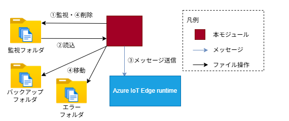
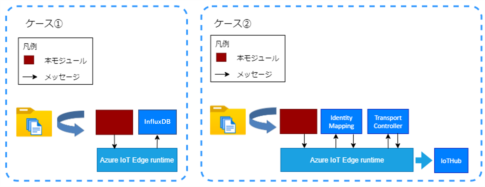
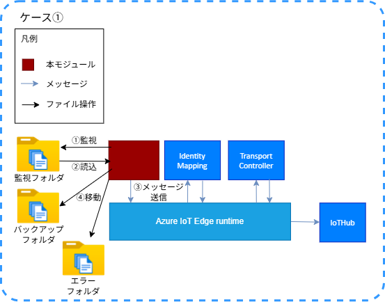
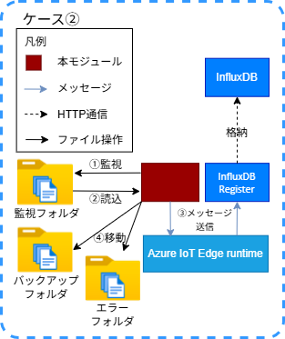

# CSVFileReceiver

## 目次
* [概要](#概要)
* [機能](#機能)
* [Quick Start](#quick-start)
* [イメージのURL](#イメージのurl)
* [動作保証環境](#動作保証環境)
* [Deployment 設定値](#deployment-設定値)
  * [環境変数](#環境変数)
  * [Desired Properties](#desired-properties)
  * [Create Option](#create-option)
  * [startupOrder](#startuporder)
* [受信メッセージ](#受信メッセージ)
* [送信メッセージ](#送信メッセージ)
  * [Message Body](#message-body)
  * [Message Properties](#message-properties)
* [Direct Method](#direct-method)
  * [SetLogLevel](#setloglevel)
  * [GetLogLevel](#getloglevel)
* [ログ出力内容](#ログ出力内容)
* [ユースケース](#ユースケース)
  * [ケース ①](#Usecase1)
  * [ケース ②](#Usecase2)
* [補足資料](#補足資料)
  * [AAA](#aaa)
* [Feedback](#feedback)
* [LICENSE](#license)

## 概要

CSVFileReceiverは、CSVファイルを監視し、検知したCSVファイルのレコードを送信するAzure IoT edgeモジュールです。

## 機能

特定のフォルダの監視を行い、特定のパターンのファイル名のCSVファイルの存在を検知して、ファイル内の行データをメッセージとして送信する。  
メッセージ送信後、作成されたCSVファイルを削除または移動する。エラー時はエラー用フォルダにファイルを移動する。  
オプションでメッセージプロパティの付与、データの変換処理（数値丸め・文字列切り出し）、ヘッダー送信、バッチ送信なども可能。  



## Quick Start
1. Personal Access tokenを作成
（参考: [個人用アクセス トークンを管理する](https://docs.github.com/ja/authentication/keeping-your-account-and-data-secure/managing-your-personal-access-tokens)）

2. リポジトリをクローン
```
git clone https://github.com/Project-GAUDI/CSVFileReceiver.git
```

3. ./src/nuget_template.configの<GITHUB_USERNAME>と<PERSONAL_ACCESS_TOKEN>を自身のユーザー名とPersonal Access tokenに書き換えて、ファイル名をnuget.configに変更してください

4. Dockerイメージをビルド
```
docker image build -t <IMAGE_NAME> ./CSVFileReceiver/src/
```
例）
```
docker image build -t ghcr.io/<YOUR_GITHUB_USERNAME>/csvfilereceiver:<VERSION> ./CSVFileReceiver/src/
```

5. Dockerイメージをコンテナレジストリにプッシュ
```
docker push <IMAGE_NAME>
```
例）
```
docker push ghcr.io/<YOUR_GITHUB_USERNAME>/csvfilereceiver:<VERSION>
```

6. Azure IoT edgeで利用

## イメージのURL
準備中
| URL                                                             | Description         |
| --------------------------------------------------------------- | ------------------- |

## 動作保証環境

| Module Version | IoTEdge | edgeAgent | edgeHub | amd64 verified on | arm64v8 verified on | arm32v7 verified on |
| -------------- | ------- | --------- | ------- | ----------------- | ------------------- | ------------------- |
| 7.1.0          | 1.6.4   | 1.6.4     | 1.6.4   | ubuntu24.04       | －                  | －                  |

## Deployment 設定値

### 環境変数

#### 環境変数の値

| Key               | Type    | Required | Conditions                                  | Default | Description                                                                                                                                  |
| ----------------- | ------- | -------- | ------------------------------------------- | ------- | -------------------------------------------------------------------------------------------------------------------------------------------- |
| TransportProtocol | string  |          | ["Amqp", "Mqtt"]                            | Amqp    | ModuleClient の接続プロトコル。                                                                                                              |
| LogLevel          | string  |          | ["trace", "debug", "info", "warn", "error"] | info    | 出力ログレベル。                                                                                                                             |
| InputPath         | string  | 〇       |                                             |         | 監視するフォルダパス。                                                                                                                       |
| BackupPath        | string  | △        | info[x].after_process=move時必須            | null    | 読み込みに成功したファイルの移動先ファイルパス。                                                                                             |
| ErrorPath         | string  | 〇       |                                             |         | 読み込みに失敗したファイルの移動先ファイルパス。                                                                                             |
| MaximumRetryCount | number  |          | 1以上の整数 ※1                              | 5       | 作成されたファイルへの最大アクセスリトライ回数。                                                                                             |
| RetryInterval     | number  |          | 0以上の整数 ※1                              | 5000    | ファイルアクセス失敗時のアクセスインターバル(ミリ秒)。                                                                                       |
| IncludeSubFolder  | boolean |          | [true,false]                                | false   | 監視するフォルダ配下のサブフォルダを監視対象に含めるかどうかのフラグ。                                                                       |
| SortKey           | string  |          | ["Name", "Date"]                            | Name    | ファイルの読込順序キー。<br>Name：ファイル名<br>Date：更新日                                                                                 |
| SortOrder         | string  |          | ["Asc", "Desc"]                             | Asc     | ファイルの読込順序。<br>Asc：昇順<br>Desc：降順                                                                                              |
| WaitTime          | number  |          | 0以上の整数 ※1                              | 0       | メッセージ送信後待機時間(ミリ秒)。<br>高頻度でファイルを処理する場合などに、IoTHubや受信側の処理能力に合わせて<br>負荷を調整するために設定。 |

### Desired Properties

#### Desired Properties の値

| JSON Key                           | Type    | Required | Conditions                                                                                    | Default                    | Description                                                                                                                                                                                                                                                                                                                                                                                                                                       |
| ---------------------------------- | ------- | -------- | --------------------------------------------------------------------------------------------- | -------------------------- | ------------------------------------------------------------------------------------------------------------------------------------------------------------------------------------------------------------------------------------------------------------------------------------------------------------------------------------------------------------------------------------------------------------------------------------------------- |
| default_info                       | object  |          |                                                                                               |                            | 全info[x]に適用する既定設定。                                                                                                                                                                                                                                                                                                                                                                                                                     |
| &emsp; max_file_size               | number  |          | -1または1以上の整数（MB）※1                                                                   | -1                         | info[x].max_file_sizeが未指定の場合に適用する入力CSVファイルのサイズ上限。<br>省略時および-1：全info[x]でサイズ制限なし。<br>1 MB = 1,000,000バイトとして、ファイル全体のバイトサイズで判定する。<br>0は指定できない。                                                                                                                                                                                                                            |
| info[x]                            | object  | 〇       | [x]は連番の数字                                                                               |                            | 監視するファイル情報。<br>1件も存在しない場合、監視が開始されない。                                                                                                                                                                                                                                                                                                                                                                               |
| &emsp; output_name                 | string  | 〇       |                                                                                               |                            | 送信するメッセージのアウトプット名。                                                                                                                                                                                                                                                                                                                                                                                                              |
| &emsp; error_output_name           | string  |          |                                                                                               | null                       | エラー時に送信するメッセージのアウトプット名。                                                                                                                                                                                                                                                                                                                                                                                                    |
| &emsp; after_process               | string  | 〇       | ["move","delete"]                                                                             |                            | ファイル読取後のファイル処理情報。<br>move：BackupPathで指定したパスへ移動<br>delete：削除                                                                                                                                                                                                                                                                                                                                                        |
| &emsp; filter                      | string  | 〇       | 正規表現で指定                                                                                |                            | 監視ファイルのファイル名パターン 。                                                                                                                                                                                                                                                                                                                                                                                                               |
| &emsp; encode                      | string  | 〇       | ["utf-8","shift-jis"]                                                                         |                            | 監視ファイルのエンコードタイプ。                                                                                                                                                                                                                                                                                                                                                                                                                  |
| &emsp; data_start_line             | number  | 〇       | 1以上の整数 ※1                                                                                |                            | データ部の先頭行番号。                                                                                                                                                                                                                                                                                                                                                                                                                            |
| &emsp; columns_line                | number  |          | 1以上でdata_start_line未満の整数 ※1                                                           | null                       | カラム名が記載されている行番号。<br>指定した行のデータをメッセージプロパティ(columns)としてJSON配列を文字列化した値で付与する。<br>null：columnsプロパティを付与しない                                                                                                                                                                                                                                                                            |
| &emsp; send_header_enabled         | boolean |          | [true,false]                                                                                  | false                      | ヘッダ行をメッセージ送信するか。<br>true：送信する<br>false：送信しない                                                                                                                                                                                                                                                                                                                                                                           |
| &emsp; header_start_line           | number  | △        | send_header_enabled=true時必須<br>1以上の整数 ※1                                              |                            | ヘッダ行の開始行番号。                                                                                                                                                                                                                                                                                                                                                                                                                            |
| &emsp; header_end_line             | number  |          | send_header_enabled=true時のみ有効<br>header_start_line以上で<br>data_start_line未満の整数 ※1 | header_start_line          | ヘッダ行の終了行番号。<br>省略時はheader_start_lineと同値（単一行）。                                                                                                                                                                                                                                                                                                                                                                             |
| &emsp; delimiter                   | string  |          | 1文字のみ指定可能                                                                             | ,                          | ファイルの区切り文字。                                                                                                                                                                                                                                                                                                                                                                                                                            |
| &emsp; filename_properties_enabled | boolean |          | [true,false]                                                                                  | false                      | GAUDI標準のCSVファイル命名規約（※2）に従いMessageのUserPropertiesを付与するか。<br>true：付与する<br>false：付与しない<br><br>付与するプロパティ<br>&emsp;・format（フォーマットNo.）<br>&emsp;・country（国）<br>&emsp;・company（会社）<br>&emsp;・factory（工場・棟）<br>&emsp;・data_type（データ種別）<br>&emsp;・free_area（フリーエリア）                                                                                                  |
| &emsp; data_property[y]            | object  |          | [y]は1から始まる連番                                                                          | null                       | データ部の送信メッセージに含むプロパティ情報。                                                                                                                                                                                                                                                                                                                                                                                                    |
| &emsp; &emsp; name                 | string  | △        | data_property[y]設定時必須                                                                    |                            | プロパティ名。                                                                                                                                                                                                                                                                                                                                                                                                                                    |
| &emsp; &emsp; column               | number  | △        | data_property[y]設定時必須<br>1以上の整数 ※1                                                  |                            | プロパティとしてセットするデータの列番。                                                                                                                                                                                                                                                                                                                                                                                                          |
| &emsp; &emsp; get_from             | string  | △        | data_property[y]設定時必須<br>["message", "file"]                                             |                            | プロパティとしてセットするデータの取得元。<br>message：出力メッセージ毎の先頭レコードから取得<br>file：入力ファイルの先頭レコードから取得                                                                                                                                                                                                                                                                                                         |
| &emsp; culture                     | string  |          |                                                                                               | ja-JP                      | CSVファイルの数値・日付形式の地域設定。<br>※地域により小数点記号（.または,）や日付順序（年月日/月日年/日月年）が異なる。<br>数値形式の違い<br>ja-JP: 小数点「.」桁区切り「,」 → 1,234.56<br>de-DE: 小数点「,」桁区切り「.」 → 1.234,56<br>en-US: 小数点「.」桁区切り「,」 → 1,234.56<br>日付形式の違い<br>ja-JP: yyyy/MM/dd → 2024/01/02<br>en-US: MM/dd/yyyy → 01/02/2024 (月/日/年)<br>en-GB: dd/MM/yyyy → 02/01/2024 (日/月/年)                |
| &emsp; send_max_records            | number  |          | 整数 ※1                                                                                       | 0                          | 1回のメッセージ送信で送信する最大行数。<br>1以上の数値： ファイル内で指定行数毎、または最終行に到達した時点で送信<br> 0以下の数値： ファイルの最終行に到達した時点で送信                                                                                                                                                                                                                                                                          |
| &emsp; max_message_size            | number  |          | 0<br>0.01以上0.99以下の小数（割合）<br>1以上256以下の整数（KB）                               | 0.7                        | 送信するメッセージサイズの上限を指定し、超過時にメッセージを自動分割する。<br>0：サイズによる自動分割を行わない。<br>小数値(0.01～0.99)：IoT Hubの制限(256KB)に対する割合で上限を算出する（上限=256KB×指定値）。<br>整数値(1～256)：KB単位で上限を指定。<br>メッセージ本文＋プロパティの合計サイズを基準としてレコード数を動的に分割送信する。<br>send_max_recordsと併用時は、行数上限かサイズ上限のいずれか先に達した時点で分割する。            |
| &emsp; max_file_size               | number  |          | -1または1以上の整数（MB） ※1                                                                  | default_info.max_file_size | 入力CSVファイルのサイズ上限を指定する。<br>指定時はdefault_info.max_file_sizeより優先する。<br>-1：当該info[x]のサイズ制限を無効にする。<br>0は指定できない。<br>1 MB = 1,000,000バイトとして、ファイル全体のバイトサイズで判定する。<br>上限を超えたファイルはCSVを読み込まず、エラー出力メッセージ送信後にErrorPathへ移動する。<br>本モジュールはCSV全体をメモリに読み込むため、設定値はコンテナーに割り当てたメモリの10〜20%以下を目安とする。 |
| &emsp; record_data_num             | number  |          | 整数 ※1                                                                                       | 0                          | 1レコード内の送信する最大列数を指定する。<br>1以上の数値： 指定列までのデータを送信<br>0以下の数値： すべての列を送信                                                                                                                                                                                                                                                                                                                             |
| &emsp; record_metadata_enabled     | boolean |          | [true,false]                                                                                  | false                      | 送信メッセージのRecordHeaderにファイル名と行番号を付与するか。<br>true：RecordHeaderに[ファイル名, 行番号]を付与する<br>false：RecordHeaderをJSONから省略する                                                                                                                                                                                                                                                                                     |
| &emsp; eof_enabled                 | boolean |          | [true,false]                                                                                  | false                      | ファイル処理完了後にEOFメッセージを送信するか。<br> true：空のメッセージボディでtype=eofプロパティ付きメッセージを送信<br>false：EOFメッセージを送信しない                                                                                                                                                                                                                                                                                        |
| &emsp; data_edit_option[y]         | object  |          | [y]は1から始まる連番                                                                          | null                       | データの特殊変換指定。                                                                                                                                                                                                                                                                                                                                                                                                                            |
| &emsp; &emsp; column               | number  | △        | data_edit_option[y]設定時必須<br>1以上の整数 ※1                                               |                            | 特殊変換するカラム番号。                                                                                                                                                                                                                                                                                                                                                                                                                          |
| &emsp; &emsp; mode                 | string  | △        | data_edit_option[y]設定時必須<br>["round","floor","truncate",<br>"ceiling","substring"]       |                            | 処理方法。※3<br>round：四捨五入<br>floor：切り下げ<br>truncate：切り捨て<br>ceiling：切り上げ<br>substring：文字列の一部を切り出し                                                                                                                                                                                                                                                                                                                |
| &emsp; &emsp; digits               | number  | △        | mode=round/floor/truncate/ceiling時必須<br>整数 ※1                                            |                            | 桁数指定。小数点以下や整数部の位を指定。<br>正数：小数点以下の位（例：2 → 小数第2位まで）<br> 0：1の位まで<br>負数：整数部の位（例：-1 → 10の位、-2 → 100の位）                                                                                                                                                                                                                                                                                   |
| &emsp; &emsp; output_format        | string  | △        | mode=round/floor/truncate/ceiling時必須                                                       |                            | 数値書式指定子（.NET標準数値書式文字列 ※4）。                                                                                                                                                                                                                                                                                                                                                                                                     |
| &emsp; &emsp; startindex           | number  | △        | mode=substring時必須<br>0以上の整数 ※1                                                        |                            | 部分文字列とする文字列の開始インデックス。0始まり。                                                                                                                                                                                                                                                                                                                                                                                               |
| &emsp; &emsp; length               | number  |          | mode=substring時のみ有効<br>1以上の整数または -1 ※1                                           | -1                         | 部分文字列とする文字列の長さ。<br>※ 未指定または-1を指定した場合末尾までコピーする。                                                                                                                                                                                                                                                                                                                                                              |

#### ※1 Conditionsに上限を記載していない`number`型の設定値は、実装上、`long`型の上限値が事実上の上限となる

#### ※2 filename_properties_enabledのCSVファイル命名規約

CSVファイル命名規約 ※()は桁数  
{送信先No.(3)}\_{ フォーマットNo.(3または4)}\_{ データ取得場所(15)}\_{ 可変データ(N)}.csv

データ取得場所の詳細  
・国(2)  
・会社(2)  
・工場・棟(3)  
・データ種別(3)  
・フリーエリア(5)  

#### ※3 mode=round/floor/truncate/ceilingの具体例

| 値     | round | floor | truncate | ceiling |
| ------ | ----- | ----- | -------- | ------- |
| 1.7    | 2.0   | 1.0   | 1.0      | 2.0     |
| -1.7   | -2.0  | -2.0  | -1.0     | -1.0    |
| 2.345  | 2.0   | 2.0   | 2.0      | 3.0     |
| -2.345 | -2.0  | -3.0  | -2.0     | -2.0    |

#### mode=substringの具体例

| 値        | startindex | length | substringの結果 |
| --------- | ---------- | ------ | --------------- |
| "HELLO"   | 1          | 3      | "ELL"           |
| "ABCDEFG" | 2          | 4      | "CDEF"          |
| "ABCDEFG" | 2          | -1     | "CDEFG"         |

#### ※4 .NET標準数値書式文字列の代表例

| 書式指定子 | 説明                       | 例（値=1234.5678） | 出力例    |
| ---------- | -------------------------- | ------------------ | --------- |
| F2         | 固定小数点（小数2桁）      | {0:F2}             | 1234.57   |
| N0         | 数値（3桁区切り,小数なし） | {0:N0}             | 1,235     |
| N2         | 数値（3桁区切り,小数2桁）  | {0:N2}             | 1,234.57  |
| E2         | 指数表記（小数2桁）        | {0:E2}             | 1.23E+003 |
| G          | 汎用（最適な形式で出力）   | {0:G}              | 1234.5678 |
| 0.000      | 小数点以下3桁,0埋め        | {0:0.000}          | 1234.568  |
| #,##0      | 3桁区切り,小数なし         | {0:#,##0}          | 1,235     |
| #,##0.00   | 3桁区切り,小数2桁          | {0:#,##0.00}       | 1,234.57  |

詳細は[「.NET 標準数値書式文字列」公式ドキュメント](https://learn.microsoft.com/ja-jp/dotnet/standard/base-types/standard-numeric-format-strings)を参照してください。

#### Desired Properties の記入例

```json
{
  "default_info": {
    "max_file_size": 10
  },
  "info1": {
    "output_name": "out1",
    "after_process": "move",
    "filter": "^005_017_(J|j)(P|p)0130100(G|g)30102_.+\\.(C|c)(S|s)(V|v)$",
    "encode": "shift-jis",
    "data_start_line": 2,
    "record_metadata_enabled": true
  }
}
```

### Create Option

#### Create Option の値

| JSON Key     | Type   | Required | Description                                                  |
| ------------ | ------ | -------- | ------------------------------------------------------------ |
| HostConfig   | object | 〇       |                                                              |
| &emsp; Binds | array  | 〇       | ホスト上のディレクトリとコンテナーのディレクトリのマッピング |

#### Create Option の記入例

記入の仕方は、"ホスト側のディレクトリパス:コンテナー側のディレクトリパス"の形式。  
ホスト側のディレクトリパスは、ファイルを保存したい端末のディレクトリパスを設定する。  
コンテナー側のディレクトリパスは、監視フォルダ(環境変数：InputPath)、読込成功・失敗時の移動先フォルダ(環境変数：BackupPath・ErrorPath)を設定する。  

```json
{
  "HostConfig": {
    "Binds": [
      "{監視対象フォルダ}:{環境変数：InputPath}",
      "{バックアップフォルダ}:{環境変数：BackupPath}",
      "{エラーフォルダ}:{環境変数：ErrorPath}"
    ]
  }
}
```

記入例

```json
{
  "HostConfig": {
    "Binds": [
      "/var/ftp/quality/Input:/iotedge/inputpath",
      "/var/ftp/quality/Backup:/iotedge/backuppath",
      "/var/ftp/quality/Error:/iotedge/errorpath"
    ]
  }
}
```

### startupOrder

#### startupOrder の値

| JSON Key     | Type   | Required | Conditions                   | Default    | Recommend | Description                                            |
| ------------ | ------ | -------- | ---------------------------- | ---------- | --------- | ------------------------------------------------------ |
| startupOrder | number |          | 0 以上 4294967295 以下の整数 | 4294967295 | 600       | モジュールの起動順序。数字が小さいほど先に起動される。 |

#### startupOrder の記入例

```json
{
  "startupOrder": 600
}
```

## 受信メッセージ

なし

## 送信メッセージ

### Message Body

| JSON Key            | Type         | Description                                                                                                            |
| ------------------- | ------------ | ---------------------------------------------------------------------------------------------------------------------- |
| RecordList          | object array | 各レコード（行）ごとのデータを格納するオブジェクトの配列。複数行をまとめて送信可能。                                   |
| &emsp; RecordHeader | string array | レコードに付与されるヘッダー情報。[ファイル名, 行番号]の2要素。<br>※ record_metadata_enabledがtrueの場合に付与される。 |
| &emsp; &emsp; [0]   | string       | 対象CSVファイル名 。                                                                                                   |
| &emsp; &emsp; [1]   | string       | ファイル内での行番号（1始まり）。                                                                                      |
| &emsp; RecordData   | string array | 1レコード分のデータ本体。CSVの各カラム値が格納される。                                                                 |

### Message Properties

| Key              | Description                                                                                |
| ---------------- | ------------------------------------------------------------------------------------------ |
| filename         | 検知したCSVファイル名                                                                      |
| type             | メッセージのタイプ ("eof")<br>※ EOF送信時のみ付与                                          |
| row_number       | CSVファイルをロードしてからメッセージ送信時点までの累計レコード数<br>※ 通常送信時のみ付与  |
| row_count        | 出力総レコード数<br>send_header_enabledがtrueの場合はヘッダーを含む<br>※ EOF送信時のみ付与 |
| row_total        | 読み込んだCSVのヘッダーを除くレコード数                                                    |
| columns          | ヘッダ行のデータ<br>※ columns_lineが指定されている場合のみ付与                             |
| data_property[x] | データ部に含むプロパティ情報                                                               |
| &emsp; name      | プロパティ名                                                                               |
| &emsp; column    | プロパティの値                                                                             |
| country          | 国<br>※ filename_properties_enabledがtrueの場合のみ付与                                    |
| company          | 会社<br>※ filename_properties_enabledがtrueの場合のみ付与                                  |
| factory          | 工場・棟<br>※ filename_properties_enabledがtrueの場合のみ付与                              |
| data_type        | データ種別<br>※ filename_properties_enabledがtrueの場合のみ付与                            |
| free_area        | フリーエリア<br>※ filename_properties_enabledがtrueの場合のみ付与                          |
| format           | フォーマットNo.<br>※ filename_properties_enabledがtrueの場合のみ付与                       |

#### Message の例

※ 以下は `record_metadata_enabled` が `true` の場合の例。`false`（デフォルト）の場合、`RecordHeader` はJSONから省略される。

```JSON
{
  "Body":{
    "RecordList": [
      {
        "RecordHeader": ["005_017_JP0130100g30102_20240115.csv","1"],
        "RecordData": ["2024-01-15 10:00:00","1.234","2.567","25.8","60.2"]
      }
    ]
  },
  "Properties": {
    "filename": "005_017_JP0130100g30102_20240115.csv",
    "row_number": "1",
    "row_total": "2"
  }
}
```

#### EOFメッセージの例

EOFメッセージはBodyが空もしくは省略される（Propertiesのみ）

```JSON
{
  "Body": {},
  "Properties": {
    "filename": "005_017_JP0130100g30102_20240115.csv",
    "type": "eof",
    "row_count": "2"
  }
}
```

## Direct Method

### SetLogLevel

* 機能概要

  実行中に一時的にLogLevelを変更する。<br>
  変更はモジュール起動中または有効時間を過ぎるまで有効。<br>

* payload

  | JSON Key      | Type    | Required | default | Description |
  | ------------- | ------- | -------- | -------- | ----------- |
  | EnableSec     | integer  | 〇       |          | 有効時間(秒)。<br>-1:無期限<br>0:リセット(環境変数LogLevel相当に戻る)<br>1以上：指定時間(秒)経過まで有効。  |
  | LogLevel      | string  | △       |          | EnableSec=0以外を指定時必須。指定したログレベルに変更する。<br>["trace", "debug", "info", "warn", "error"]  |

  １時間"trace"レベルに変更する場合の設定例

  ```json
  {
    "EnableSec": 3600,
    "LogLevel": "trace"
  }
  ```

* response

  | JSON Key      | Type    | Description |
  | ------------- | ------- | ----------- |
  | status          | integer | 処理ステータス。<br>0:正常終了<br>その他:異常終了         |
  | payload          | object  | レスポンスデータ。         |
  | &nbsp; CurrentLogLevel | string  | 設定後のログレベル。（正常時のみ）<br>["trace", "debug", "info", "warn", "error"]  |
  | &nbsp; Error | string  | エラーメッセージ（エラー時のみ）  |

  ```json
  {
    "status": 0,
    "paylaod":
    {
      "CurrentLogLevel": "trace"
    }
  }
  ```

### GetLogLevel

* 機能概要

  現在有効なLogLevelを取得する。<br>
  通常は、LogLevel環境変数の設定値が返り、SetLogLevelで設定した有効時間内の場合は、その設定値が返る。<br>

* payload

  なし

* response

  | JSON Key      | Type    | Description |
  | ------------- | ------- | ----------- |
  | status          | integer | 処理ステータス。<br>0:正常終了<br>その他:異常終了         |
  | payload          | object  | レスポンスデータ。         |
  | &nbsp; CurrentLogLevel | string  | 現在のログレベル。（正常時のみ）<br>["trace", "debug", "info", "warn", "error"]  |
  | &nbsp; Error | string  | エラーメッセージ（エラー時のみ）  |

  ```json
  {
    "status": 0,
    "paylaod":
    {
      "CurrentLogLevel": "trace"
    }
  }
  ```

## ログ出力内容

| LogLevel | 出力概要                                                                                                                                                                                                                                                                                                                                                                            |
| -------- | ----------------------------------------------------------------------------------------------------------------------------------------------------------------------------------------------------------------------------------------------------------------------------------------------------------------------------------------------------------------------------------- |
| error    | [初期化/モジュールツイン更新/読み込みファイル検索/ファイル監視イベント作成/ファイル検出/モジュールツイン取り込み/<br>エラー情報送信/ファイルオープン/エッジランタイムとの接続/ファイル削除/ファイル移動/メッセージ送信]失敗<br>[環境変数/モジュールツイン]の必須項目未設定<br>[Input/Backup/Error]Pathが存在しないパス<br>[環境変数/モジュールツイン]がConditionsまたはType制約違反 |
| warn     | [ファイルオープン/エッジランタイムとの接続/ファイル削除/ファイル移動]リトライ失敗                                                                                                                                                                                                                                                                                                   |
| info     | [環境変数/モジュールツイン]の値<br>モジュールツイン更新通知<br>[環境変数/モジュールツイン]の省略可能項目未設定のためDefault値適用<br>バックアップ無効化<br>ファイル検出<br>[メッセージ/EOFメッセージ]送信完了<br>エラー情報送信完了                                                                                                                                                 |
| debug    | 無し                                                                                                                                                                                                                                                                                                                                                                                |
| trace    | メソッドの開始・終了<br>csvからレコード取得<br>レコードの除去行<br>ヘッダー[スキップ/カウント/フィルター]<br>ヘッダーの[レコード/レコード行]<br>処理対象データのターゲット情報<br>取得レコード数<br>サンプリング間隔<br>処理ファイルタイプ・行数<br>1メッセージあたりの送信最大行数<br>メッセージサイズ<br>送信レコード数<br>送信メッセージ数・output名                             |

## ユースケース

ケース① : ある決まったフォルダ(サブフォルダを含まない)に不定期間隔でアップロードされるCSVファイルを読み取り、InfluxDBにデータを格納する。<br>
ケース② : ある決まったフォルダ(サブフォルダを含む)に不定期間隔でアップロードされるCSVファイルを読み取り、IoTHubに送信する。



<a id="Usecase1"></a>

### ケース ①

ある決まったフォルダ(サブフォルダを含む)にアップロードされるCSVファイルを読み取り、IoTHubに送信する。



#### 設定

##### 処理条件

* 監視するフォルダ内（サブフォルダを含む）にファイルが存在する
* ファイル名のフォーマットが"005\_017\_JP0130100g30102\_{任意の文字列}.csv"である

##### ファイル仕様

* ファイルのエンコード文字列がshift-jisである
* 文字列はカンマ区切りである
* 最初の1行目はヘッダー行である

##### 処理内容

* 読取りを完了したファイルは別フォルダへ移動する
* ヘッダー部をメッセージデータとして送信しない
* カラム名行（1行目）をメッセージプロパティ(columns)として付与する
* ファイル読込完了後に通知メッセージを送信しない
* CSVファイル名からメタデータを設定しない

#### 起動順序 startupOrder

| 名称         | 値  |
| ------------ | --- |
| startupOrder | 600 |

#### 環境変数

| 名称              | 値                      |
| ----------------- | ----------------------- |
| TransportProtocol | Amqp                    |
| LogLevel          | info                    |
| InputPath         | /iotedge/storage/input  |
| BackupPath        | /iotedge/storage/backup |
| ErrorPath         | /iotedge/storage/error  |
| MaximumRetryCount | 5                       |
| RetryInterval     | 5000                    |
| IncludeSubFolder  | true                    |
| SortKey           | Name                    |
| SortOrder         | Asc                     |
| WaitTime          | 0                       |

#### コンテナーの作成オプション Create Option

```json
{
  "HostConfig": {
    "Binds": [
      "/host/input:/iotedge/storage/input",
      "/host/backup:/iotedge/storage/backup",
      "/host/error:/iotedge/storage/error"
    ]
  }
}
```

#### モジュールツインの設定

```json
{
  "info1": {
    "output_name": "out1",
    "after_process": "move",
    "filter": "^005_017_(J|j)(P|p)0130100(G|g)30102_.+\\.(C|c)(S|s)(V|v)$",
    "encode": "shift-jis",
    "data_start_line": 2,
    "columns_line": 1
  }
}
```

#### 入力内容

##### CSVファイル例

005_017_JP0130100g30102_20240115.csv

```csv
timestamp,sensor1,sensor2,temperature,humidity
2024-01-15 10:00:00,1.234,2.567,25.8,60.2
2024-01-15 10:01:00,1.456,2.789,26.1,59.8
```

#### 出力結果

##### 出力メッセージ

```JSON
{
  "Body":{
    "RecordList": [
      {
        "RecordData": ["2024-01-15 10:00:00","1.234","2.567","25.8","60.2"]
      },
      {
        "RecordData": ["2024-01-15 10:01:00","1.456","2.789","26.1","59.8"]
      }
    ]
  },
  "Properties": {
    "filename": "005_017_JP0130100g30102_20240115.csv",
    "row_number": "1",
    "row_total": "2",
    "columns": "[\"timestamp\",\"sensor1\",\"sensor2\",\"temperature\",\"humidity\"]"
  }
}
```

#### エラー時の動作

##### エラーケース

ファイル読み込みエラーが発生した場合

##### 結果

* ファイルが`/iotedge/storage/error`に移動
* error_output_nameが設定されていないため、エラーメッセージは送信されない

<a id="Usecase2"></a>

### ケース ②

ある決まったフォルダ(サブフォルダを含まない)にアップロードされるCSVファイルを読み取り、InfluxDBにデータを格納する。



#### 設定

##### 処理条件

* 監視するフォルダ内（サブフォルダを含まない）にファイルが存在する
* ファイル名のフォーマットが"005\_007\_JP0130100430103\_{任意の文字列}.csv"である
* ファイルのエンコード文字列がshift-jisである
* 最初の1行目はヘッダー行である

##### ファイル仕様

* ファイルのエンコード文字列がshift-jisである
* 文字列はカンマ区切りである
* 最初の1行目はヘッダー行である

##### 処理内容

* 読取りを完了したファイルは別フォルダへ移動する
* CSVのデータ行の10カラム目に数値変換処理を実施（mode: truncate, digits: 5, output_format: "E6"）
* ヘッダー部をメッセージデータとして送信する
* ファイル読込完了後に通知メッセージを送信する
* CSVファイル名からメタデータを設定する

#### 起動順序 startupOrder

| 名称         | 値  |
| ------------ | --- |
| startupOrder | 600 |

#### 環境変数

| 名称              | 値                      |
| ----------------- | ----------------------- |
| TransportProtocol | Amqp                    |
| LogLevel          | info                    |
| InputPath         | /iotedge/storage/input  |
| BackupPath        | /iotedge/storage/backup |
| ErrorPath         | /iotedge/storage/error  |
| MaximumRetryCount | 5                       |
| RetryInterval     | 5000                    |
| IncludeSubFolder  | false                   |
| SortKey           | Name                    |
| SortOrder         | Asc                     |
| WaitTime          | 0                       |

#### コンテナーの作成オプション Create Option

```json
{
  "HostConfig": {
    "Binds": [
      "/host/input:/iotedge/storage/input",
      "/host/backup:/iotedge/storage/backup",
      "/host/error:/iotedge/storage/error"
    ]
  }
}
```

#### モジュールツインの設定

```json
{
  "info1": {
    "output_name": "out1",
    "error_output_name": "output_err",
    "after_process": "move",
    "filter": "^005_007_(J|j)(P|p)0130100430103_.+\\.(C|c)(S|s)(V|v)$",
    "encode": "shift-jis",
    "data_start_line": 2,
    "send_header_enabled": true,
    "header_start_line": 1,
    "filename_properties_enabled": true,
    "record_metadata_enabled": true,
    "data_property1": {
      "name": "machine_number",
      "column": 4,
      "get_from": "message"
    },
    "data_property2": {
      "name": "die_number",
      "column": 5,
      "get_from": "message"
    },
    "data_property3": {
      "name": "product_yy",
      "column": 6,
      "get_from": "message"
    },
    "data_property4": {
      "name": "product_mm",
      "column": 7,
      "get_from": "message"
    },
    "data_property5": {
      "name": "product_dd",
      "column": 8,
      "get_from": "message"
    },
    "data_property6": {
      "name": "shot_count",
      "column": 9,
      "get_from": "message"
    },
    "eof_enabled": true,
    "data_edit_option1": {
      "column": 10,
      "mode": "truncate",
      "digits": 5,
      "output_format": "E6"
    }
  }
}
```

#### 入力内容

##### CSVファイル

005_007_JP0130100430103_20240115.csv

```csv
timestamp,sensor1,sensor2,machine_no,die_no,prod_yy,prod_mm,prod_dd,shot_cnt,energy_value
2024-01-15 10:00:00,1.234,2.567,M001,D001,24,01,15,100,1.234567890123
2024-01-15 10:01:00,1.456,2.789,M001,D001,24,01,15,101,2.345678901234
```

#### 出力結果

##### 出力メッセージ_通常送信

```json
{
  "Body": {
    "RecordList": [
      {
        "RecordHeader": ["005_007_JP0130100430103_20240115.csv","1"],
        "RecordData": ["timestamp","sensor1","sensor2","machine_no","die_no","prod_yy","prod_mm","prod_dd",
                       "shot_cnt","energy_value"]
      },
      {
        "RecordHeader": ["005_007_JP0130100430103_20240115.csv","2"],
        "RecordData": ["2024-01-15 10:00:00","1.234","2.567","M001","D001","24","01","15","100","1.234560E+000"]
      },
      {
        "RecordHeader": ["005_007_JP0130100430103_20240115.csv","3"],
        "RecordData": ["2024-01-15 10:01:00","1.456","2.789","M001","D001","24","01","15","101","2.345670E+000"]
      }
    ]
  },
  "Properties": {
    "filename": "005_007_JP0130100430103_20240115.csv",
    "row_number": "1",
    "row_total": "2",
    "machine_number": "M001",
    "die_number": "D001",
    "product_yy": "24",
    "product_mm": "01",
    "product_dd": "15",
    "shot_count": "100",
    "country": "JP",
    "company": "01",
    "factory": "301",
    "data_type": "004",
    "free_area": "30103",
    "format": "007"
  }
}
```

##### 出力メッセージ_最終行通知

```json
{
  "Body": {},
  "Properties": {
    "filename": "005_007_JP0130100430103_20240115.csv",
    "type": "eof",
    "row_count": "3",
    "row_total": "2",
    "machine_number": "M001",
    "die_number": "D001",
    "product_yy": "24",
    "product_mm": "01",
    "product_dd": "15",
    "shot_count": "100",
    "country": "JP",
    "company": "01",
    "factory": "301",
    "data_type": "004",
    "free_area": "30103",
    "format": "007"
  }
}
```

#### エラー時の動作

##### エラーケース

入力ファイルの10カラム目が数値変換できない場合

```csv
2024-01-15 10:00:00,1.234,2.567,M001,D001,24,01,15,100,invalid_text
```

##### 結果

* ファイルが/iotedge/storage/errorに移動
* output_errにエラーメッセージ送信

```json
{
  "Body": {
    "RecordList": [
      {
        "RecordHeader": [],
        "RecordData": []
      }
    ]
  },
  "Properties": {
    "filename": "005_007_JP0130100430103_20240115.csv"
  }
}
```

<a id="Usecase3"></a>

### ケース ③

ある決まったフォルダ（サブフォルダを含まない）にアップロードされるCSVファイルを読み取り、レコード数上限およびメッセージサイズ上限に従って分割送信する。  
RecordHeaderは省略し、ファイル処理完了後にEOFメッセージを送信する。


#### 設定

##### 処理条件

* 監視するフォルダ内（サブフォルダを含まない）にファイルが存在する
* ファイル名のフォーマットが"data_{任意の文字列}.csv"である

##### ファイル仕様

* ファイルのエンコード文字列がutf-8である
* 文字列はカンマ区切りである
* 最初の1行目はヘッダー行である

##### 処理内容

* 読取りを完了したファイルは削除する
* 1メッセージあたり最大3レコードで分割送信する
* メッセージサイズが1KBを超えないように分割送信する（レコード数上限またはサイズ上限のいずれか先に達した時点で分割）
* RecordHeaderをメッセージに含めない
* カラム名行（1行目）の情報をメッセージプロパティ（columns）として付与する
* ファイル読込完了後にEOF通知メッセージを送信する

#### 起動順序 startupOrder

| 名称         | 値  |
| ------------ | --- |
| startupOrder | 600 |

#### 環境変数

| 名称              | 値                     |
| ----------------- | ---------------------- |
| TransportProtocol | Amqp                   |
| LogLevel          | info                   |
| InputPath         | /iotedge/storage/input |
| ErrorPath         | /iotedge/storage/error |
| MaximumRetryCount | 5                      |
| RetryInterval     | 5000                   |
| IncludeSubFolder  | false                  |
| SortKey           | Name                   |
| SortOrder         | Asc                    |
| WaitTime          | 0                      |

#### コンテナーの作成オプション Create Option

```json
{
  "HostConfig": {
    "Binds": [
      "/host/input:/iotedge/storage/input",
      "/host/error:/iotedge/storage/error"
    ]
  }
}
```

#### モジュールツインの設定

```json
{
  "info1": {
    "output_name": "out1",
    "after_process": "delete",
    "filter": "^data_.+\\.csv$",
    "encode": "utf-8",
    "data_start_line": 2,
    "columns_line": 1,
    "send_max_records": 3,
    "max_message_size": 1,
    "eof_enabled": true
  }
}
```

#### 入力内容

##### CSVファイル

data_20240201.csv

※ 実際のCSVデータには改行なし（可読性のため改行して記載）

```csv
timestamp,device_id,location,type,value1,value2,value3,status
2024-02-01 10:00:00,TEMP_SENSOR_A001,
PLANT_BLDG3_FL3_RM301_ZONEALPHA_SEGMENTA01_SEGMENTA02_SEGMENTA03_SEGMENTA04_SEGMENTA05_
SEGMENTA06_SEGMENTA07_SEGMENTA08_SEGMENTA09_SEGMENTA10_SEGMENTA11_SEGMENTA12_SEGMENTA13_
SEGMENTA14_SEGMENTA15,TEMPERATURE,123.4567890,234.5678901,345.6789012,
NORMAL_VERIFIED_BATCHSIZE_TRIGGER_ALPHA_BLOCK01_BLOCK02_BLOCK03_BLOCK04_BLOCK05_BLOCK06_
BLOCK07_EXTRA_LARGE_DATA_CHUNK_001
2024-02-01 10:01:00,PRES_SENSOR_B002,
PLANT_BLDG5_FL5_RM502_ZONEBETA_SEGMENTB01_SEGMENTB02_SEGMENTB03_SEGMENTB04_SEGMENTB05_
SEGMENTB06_SEGMENTB07_SEGMENTB08_SEGMENTB09_SEGMENTB10_SEGMENTB11_SEGMENTB12_SEGMENTB13_
SEGMENTB14_SEGMENTB15,PRESSURE,223.4567890,334.5678901,445.6789012,
NORMAL_VERIFIED_BATCHSIZE_TRIGGER_BETA_BLOCK01_BLOCK02_BLOCK03_BLOCK04_BLOCK05_BLOCK06_
BLOCK07_EXTRA_LARGE_DATA_CHUNK_002
2024-02-01 10:02:00,SENS_C003,PLT_1F,FLOW,1.23,2.34,3.45,OK
2024-02-01 10:03:00,SENS_D004,PLT_2F,TEMP,1.24,2.35,3.46,OK
2024-02-01 10:04:00,SENS_E005,PLT_3F,PRES,1.25,2.36,3.47,OK
```

#### 出力結果

##### 出力メッセージ_サイズ上限到達で送信

3レコード目を追加するとメッセージサイズが1KBを超えるため、2レコードで分割送信する。

※ 実際のメッセージデータには改行なし（可読性のため整形して記載）

```json
{
  "Body": {
    "RecordList": [
      {
        "RecordData": [
          "2024-02-01 10:00:00",
          "TEMP_SENSOR_A001",
          "PLANT_BLDG3_FL3_RM301_ZONEALPHA_SEGMENTA01_SEGMENTA02_SEGMENTA03_SEGMENTA04_SEGMENTA05_SEGMENTA06_SEGMENTA07_
          SEGMENTA08_SEGMENTA09_SEGMENTA10_SEGMENTA11_SEGMENTA12_SEGMENTA13_SEGMENTA14_SEGMENTA15",
          "TEMPERATURE",
          "123.4567890",
          "234.5678901",
          "345.6789012",
          "NORMAL_VERIFIED_BATCHSIZE_TRIGGER_ALPHA_BLOCK01_BLOCK02_BLOCK03_BLOCK04_BLOCK05_BLOCK06_BLOCK07_EXTRA_LARGE_DATA_CHUNK_001"
        ]
      },
      {
        "RecordData": [
          "2024-02-01 10:01:00",
          "PRES_SENSOR_B002",
          "PLANT_BLDG5_FL5_RM502_ZONEBETA_SEGMENTB01_SEGMENTB02_SEGMENTB03_SEGMENTB04_SEGMENTB05_SEGMENTB06_SEGMENTB07_
          SEGMENTB08_SEGMENTB09_SEGMENTB10_SEGMENTB11_SEGMENTB12_SEGMENTB13_SEGMENTB14_SEGMENTB15",
          "PRESSURE",
          "223.4567890",
          "334.5678901",
          "445.6789012",
          "NORMAL_VERIFIED_BATCHSIZE_TRIGGER_BETA_BLOCK01_BLOCK02_BLOCK03_BLOCK04_BLOCK05_BLOCK06_BLOCK07_EXTRA_LARGE_DATA_CHUNK_002"
        ]
      }
    ]
  },
  "Properties": {
    "filename": "data_20240201.csv",
    "row_number": "1",
    "row_total": "5",
    "columns": "[\"timestamp\",\"device_id\",\"location\",\"type\",\"value1\",\"value2\",\"value3\",\"status\"]"
  }
}
```

##### 出力メッセージ_レコード数上限到達で送信

send_max_records=3に到達したため送信する。

```json
{
  "Body": {
    "RecordList": [
      {
        "RecordData": ["2024-02-01 10:02:00","SENS_C003","PLT_1F",
                       "FLOW","1.23","2.34","3.45","OK"]
      },
      {
        "RecordData": ["2024-02-01 10:03:00","SENS_D004","PLT_2F",
                       "TEMP","1.24","2.35","3.46","OK"]
      },
      {
        "RecordData": ["2024-02-01 10:04:00","SENS_E005","PLT_3F",
                       "PRES","1.25","2.36","3.47","OK"]
      }
    ]
  },
  "Properties": {
    "filename": "data_20240201.csv",
    "row_number": "3",
    "row_total": "5",
    "columns": "[\"timestamp\",\"device_id\",\"location\",\"type\",\"value1\",\"value2\",\"value3\",\"status\"]"
  }
}
```

##### 出力メッセージ_EOF通知

```json
{
  "Body": {},
  "Properties": {
    "filename": "data_20240201.csv",
    "type": "eof",
    "row_count": "5",
    "row_total": "5",
    "columns": "[\"timestamp\",\"device_id\",\"location\",\"type\",\"value1\",\"value2\",\"value3\",\"status\"]"
  }
}
```

#### エラー時の動作

##### エラーケース

ファイル読み込みエラーが発生した場合

##### 結果

* ファイルが`/iotedge/storage/error`に移動
* error_output_nameが設定されていないため、エラーメッセージは送信されない

## Feedback
お気づきの点があれば、ぜひIssueにてお知らせください。

## LICENSE
CSVFileReceiver is licensed under the MIT License, see the [LICENSE](LICENSE) file for details.
